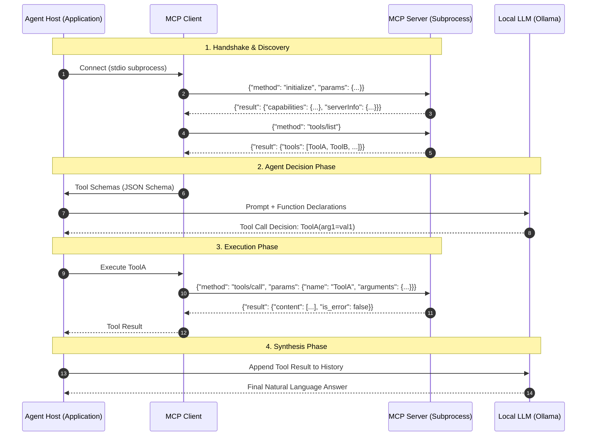

# Model Context Protocol (MCP) Deep Dive & Python Guide

A comprehensive, runnable repository demonstrating how the **Model Context Protocol (MCP)** connects AI agents to external tools, data sources, and prompt templates, and how LLM agents reason and decide which tools to execute.

---

## Table of Contents
1. [What is the Model Context Protocol (MCP)?](#what-is-the-model-context-protocol-mcp)
2. [The Architecture: Host, Client, and Server](#the-architecture-host-client-and-server)
3. [How Do Agents Decide Which Tool to Call?](#how-do-agents-decide-which-tool-to-call)
   - [The Schema-Attention Pipeline](#1-the-schema-attention-pipeline)
   - [Sequential Reasoning & The ReAct Loop](#2-sequential-reasoning--the-react-loop)
   - [Error Handling & Self-Correction](#3-error-handling--self-correction)
   - [Scaling to 50+ Tools: Dynamic Semantic Pruning](#4-scaling-to-50-tools-dynamic-semantic-pruning)
4. [The Three Pillars of MCP](#the-three-pillars-of-mcp)
5. [Repository Structure](#repository-structure)
6. [Quick Start & Setup](#quick-start--setup)
7. [Running the Examples (01 to 07)](#running-the-examples)
8. [Automated Verification Suite](#automated-verification-suite)

---

## What is the Model Context Protocol (MCP)?

Before MCP, integrating $N$ AI frameworks/models (Ollama, Claude, Gemini, OpenAI, LangChain) with $M$ internal and external tools (PostgreSQL, GitHub, Slack, Jira, local filesystems) required $N \times M$ bespoke, custom integrations.

```
Without MCP (N × M integrations):
Models (Claude, Ollama, GPT)  <══════════════>  Tools (Postgres, GitHub, Slack, Jira, FS)
                                 (Custom code per pair)

With MCP (N + M standardized protocol):
Models (Ollama, Claude, GPT)  ──> [MCP Client]
                                        │ (JSON-RPC 2.0 over Stdio / SSE)
                                        ▼
                                  [MCP Servers] ──> (Postgres, GitHub, Slack, Jira, FS)
```

With **MCP**, tool creators write a single **MCP Server** exposing their functionality, and application builders implement an **MCP Client**. Every model can now talk to every tool seamlessly using open-standard **JSON-RPC 2.0** over standard I/O (`stdio`) or Server-Sent Events (`SSE/HTTP`).

---

## The Architecture: Host, Client, and Server



1. **Host**: The user-facing agent runtime orchestrating conversations, memory, and LLM calls.
2. **Client**: A protocol client that maintains subprocesses or HTTP sessions, sending JSON-RPC requests (`initialize`, `tools/list`, `tools/call`, `resources/read`, `prompts/get`).
3. **Server**: An isolated, lightweight service exposing executable **Tools**, passive **Resources**, and reusable **Prompts**.
4. **LLM**: The reasoning engine (such as local Ollama `gemma4:12b` or `qwen3.8:27b`) that decides when and how to call tools.

---

## How Do Agents Decide Which Tool to Call?

The mechanism by which an LLM decides which tool to call involves four key stages:

### 1. The Schema-Attention Pipeline
When tools are registered in MCP, each tool has:
- A `name` (e.g., `get_current_weather`, `get_weather_forecast`)
- A `description` (derived from docstrings)
- An `inputSchema` (JSON Schema declaring parameter names, types, descriptions, and required fields)

The client converts these schemas into the model's function-calling format:
```json
{
  "type": "function",
  "function": {
    "name": "get_current_weather",
    "description": "Retrieve real-time current weather metrics for a specified city.",
    "parameters": {
      "type": "object",
      "properties": {
        "city": {"type": "string", "description": "The name of the city."}
      },
      "required": ["city"]
    }
  }
}
```
During inference, the model's self-attention heads compute cross-attention between the user's prompt tokens (e.g. *"current temperature in Tokyo right now"*) and the tool definition tokens (*"real-time current weather"*, *"temperature"*, *"city"*). 
The attention weights strongly bias the model's logits toward emitting a structured `tool_calls` token block for `get_current_weather` with argument `{"city": "Tokyo"}` rather than `get_weather_forecast`.

### 2. Sequential Reasoning & The ReAct Loop
Complex tasks cannot be satisfied by one tool call. Agents use a **ReAct** (Reasoning + Acting) loop:
1. **Turn 1**: User asks: *"Find Alice's total spend and calculate a 15% discount."*
2. **Step 1**: Model chooses `db__query_customers(search_term="Alice")`. Server returns `{"spend_usd": 4250.00}`.
3. **Step 2**: The client injects the result into conversation history with role `tool`.
4. **Step 3**: The model reads its prior reasoning and the returned `$4250.00`, then emits a second tool call: `math__multiply(a=4250.0, b=0.15)`. Server returns `637.50`.
5. **Step 4**: The model recognizes all required data is collected and synthesizes the final response.

### 3. Error Handling & Self-Correction
If a tool execution fails (e.g., calling `factorial(n=-5)` or querying a nonexistent record), MCP returns:
```json
{
  "is_error": true,
  "content": "ValueError: Factorial is only defined for non-negative integers."
}
```
The agent receives this error message in its context window. Rather than crashing, the agent's reasoning loop evaluates the error message, determines that negative numbers are invalid for factorial, and self-corrects or clarifies with the user.

### 4. Scaling to 50+ Tools: Dynamic Semantic Pruning
In enterprise deployments with dozens of MCP servers (CRM, Kubernetes, Jira, Billing, Databases), injecting 50+ tool schemas into every prompt:
- Consumes **6,000+ to 15,000+ context tokens** per turn.
- Significantly increases latency and API costs.
- Causes **attention dispersion**, where the model confuses similar tools and hallucinates parameters.

**Solution**: This project implements **Dynamic Semantic Pruning (Tool RAG)** in [`core/tool_registry.py`](file:///c:/Users/iamvi/MyProjects/POC/MCP_examples/core/tool_registry.py). It indexes all registered tools, filters out stop words, and computes relevance scores against the user's intent to retrieve only the top $K$ (e.g. top 3) most relevant tools. This achieves an **80%+ context reduction** while boosting tool selection accuracy.

---

## The Three Pillars of MCP

MCP is frequently misunderstood as just a "tool calling format". In fact, MCP defines three first-class primitives:

| Primitive | Purpose | Analogy | Example |
| :--- | :--- | :--- | :--- |
| **Tools** | Executable actions with arguments and side-effects. | `POST` / RPC endpoints | `math__multiply`, `fs__write_sandbox_file` |
| **Resources** | Read-only context data referenced by URI. | `GET` file / document | `db://schema/customers`, `file:///logs/today.txt` |
| **Prompts** | Reusable, parameterized prompt templates stored on servers. | Slash command / template | `customer_summary_prompt(customer_name=...)` |

---

## Repository Structure

```
MCP_examples/
├── pyproject.toml                 # Dependencies (mcp, ollama, rich, pytest, pydantic)
├── README.md                      # Complete architectural and usage guide
├── runner.py                      # Interactive CLI terminal menu to run all examples
│
├── servers/                       # Standalone MCP Servers (stdio transport)
│   ├── __init__.py
│   ├── math_server.py             # Arithmetic, factorial, and power tools
│   ├── weather_server.py          # Real-time weather and forecast tools
│   ├── database_server.py         # DB tools, schema resources (db://), and prompt templates
│   └── filesystem_server.py       # Safe sandboxed file operations
│
├── core/                          # Core Framework & Agent Engine
│   ├── __init__.py
│   ├── client.py                  # Low-level stdio MCPClient with syntax-highlighted JSON-RPC telemetry
│   ├── multi_client.py            # MultiServerMCPClient aggregator with namespacing
│   ├── tool_registry.py           # Schema converter (MCP -> Ollama format) & Dynamic Tool Pruning
│   └── llm_adapter.py             # OllamaAgent (local model runner) & MockAgent (offline simulation)
│
├── examples/                      # Progressive Demos (Basic -> Advanced)
│   ├── 01_protocol_handshake.py   # BASIC: Low-level JSON-RPC initialize, tools/list, tools/call
│   ├── 02_llm_tool_selection.py   # INTERMEDIATE: Attention & schema-based tool decision making
│   ├── 03_multi_turn_chaining.py  # INTERMEDIATE: ReAct loop chaining Database -> Math -> Synthesis
│   ├── 04_error_handling_recovery.py # INTERMEDIATE: Exception propagation & agent self-correction
│   ├── 05_multi_server_hub.py     # ADVANCED: Coordinating Weather + Filesystem + Math servers
│   ├── 06_dynamic_tool_routing.py # ADVANCED: Dynamic Semantic Pruning (Tool RAG) for 50+ tools
│   └── 07_resources_and_prompts.py# ADVANCED: Beyond tools: Reading MCP Resources and Prompts
│
└── tests/                         # Automated Pytest Suite
    ├── __init__.py
    ├── test_servers.py            # Unit tests for all tool and resource functions
    └── test_agent_selection.py    # Tests for registry, routing, Ollama conversion, and mock agent
```

---

## Quick Start & Setup

The project uses Python 3.11+ and `uv` (or standard `venv`).

### 1. Environment Setup
```powershell
# Create and activate virtual environment
uv venv .venv
.venv\Scripts\activate

# Install dependencies
uv pip install -e .
```

### 2. Verify Local Ollama
The project works out of the box with your locally installed Ollama models:
```powershell
ollama list
# Supported models: gemma4:12b, qwen3.8:27b, etc.
```

*(Note: All examples also support `--mock` mode, which runs 100% offline in milliseconds with zero model overhead!)*

---

## Running the Examples

### The Interactive Runner
The easiest way to explore all examples is using the interactive visual runner:
```powershell
.venv\Scripts\python.exe runner.py
```

### Running Individual Examples

#### 1. Basic Protocol Inspection: Handshake & Direct Calls
Inspects the physical JSON-RPC 2.0 frames (`initialize`, `tools/list`, `tools/call`):
```powershell
.venv\Scripts\python.exe examples/01_protocol_handshake.py
```

#### 2. How LLMs Decide Which Tool to Call
Demonstrates how the model parses parameter schemas and selects between real-time weather vs. multi-day forecasts:
```powershell
# With local Ollama (gemma4:12b)
.venv\Scripts\python.exe examples/02_llm_tool_selection.py

# With deterministic simulation
.venv\Scripts\python.exe examples/02_llm_tool_selection.py --mock
```

#### 3. Multi-Turn Tool Chaining (ReAct Loop)
Demonstrates sequential multi-tool reasoning where the output of Tool 1 (customer spend) is passed to Tool 2 (discount multiplication):
```powershell
.venv\Scripts\python.exe examples/03_multi_turn_chaining.py --mock
.venv\Scripts\python.exe examples/03_multi_turn_chaining.py --model gemma4:12b
```

#### 4. Tool Error Handling & Self-Correction
Shows how domain errors (e.g. `factorial(-5)`) are formatted by MCP, inspected by the agent, and self-corrected:
```powershell
.venv\Scripts\python.exe examples/04_error_handling_recovery.py --mock
```

#### 5. Multi-Server Aggregation Hub
Connects 3 servers simultaneously (Weather, Filesystem Sandbox, Math) to execute cross-server tasks:
```powershell
.venv\Scripts\python.exe examples/05_multi_server_hub.py --mock
```

#### 6. Dynamic Tool Routing & Semantic Pruning (Scaling to 50+ Tools)
Demonstrates semantic indexing and keyword retrieval that cuts context token usage by over 80%:
```powershell
.venv\Scripts\python.exe examples/06_dynamic_tool_routing.py
```

#### 7. Beyond Tools: MCP Resources & Prompts
Demonstrates reading database schemas via `resources/read` and fetching reusable prompt templates:
```powershell
.venv\Scripts\python.exe examples/07_resources_and_prompts.py
```

---

## Automated Verification Suite

Run the full pytest suite to verify all MCP servers, schemas, tool registries, and agent routing logic:
```powershell
.venv\Scripts\python.exe -m pytest tests/ -v
```

Expected output:
```
tests/test_agent_selection.py::test_registry_registration_and_namespacing PASSED
tests/test_agent_selection.py::test_ollama_format_conversion PASSED
tests/test_agent_selection.py::test_dynamic_tool_pruning_relevance PASSED
tests/test_agent_selection.py::test_mock_agent_tool_selection PASSED
tests/test_servers.py::test_math_server_tools PASSED
tests/test_servers.py::test_weather_server_tools PASSED
tests/test_servers.py::test_database_server_tools_and_resources PASSED
tests/test_servers.py::test_filesystem_server_sandbox PASSED
============================== 8 passed in 1.79s ==============================
```
